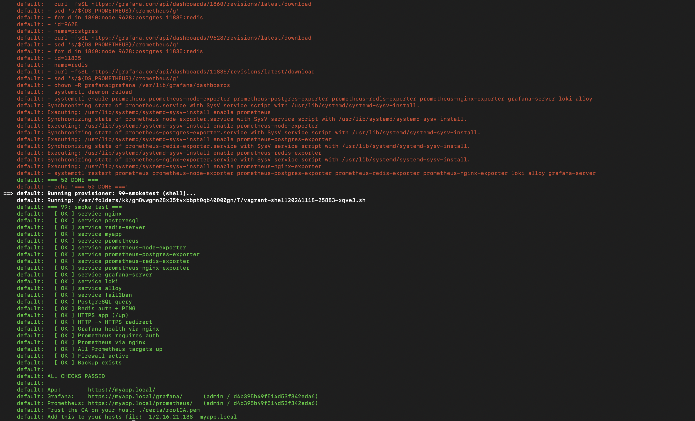
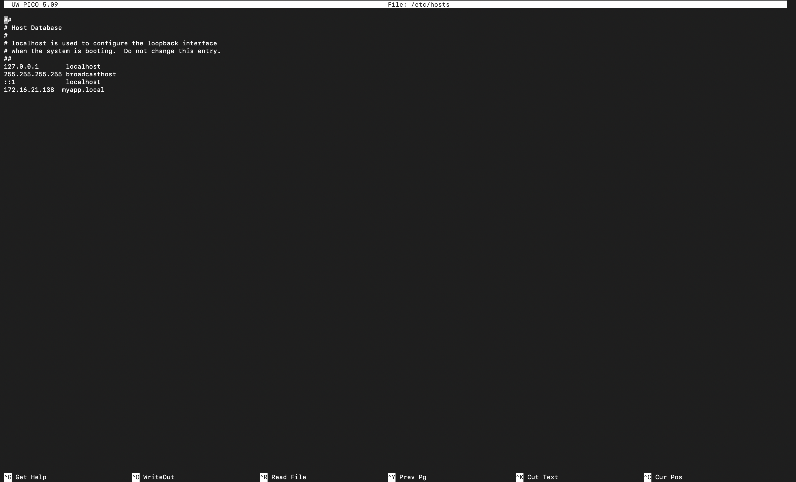
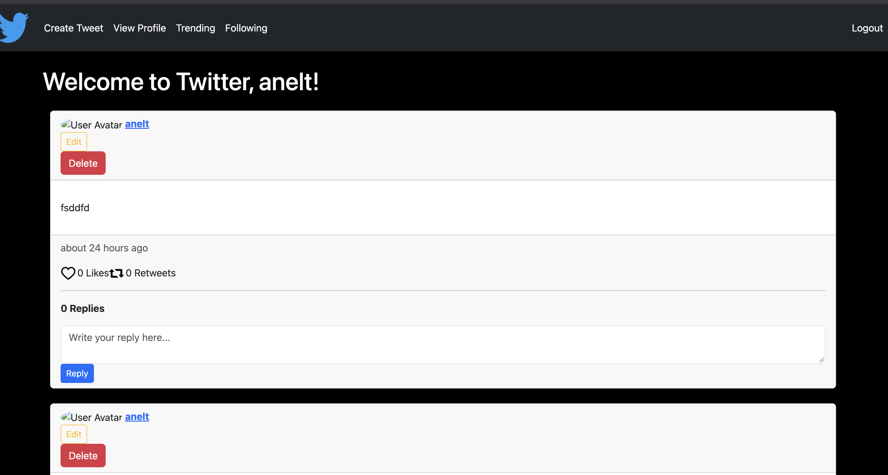
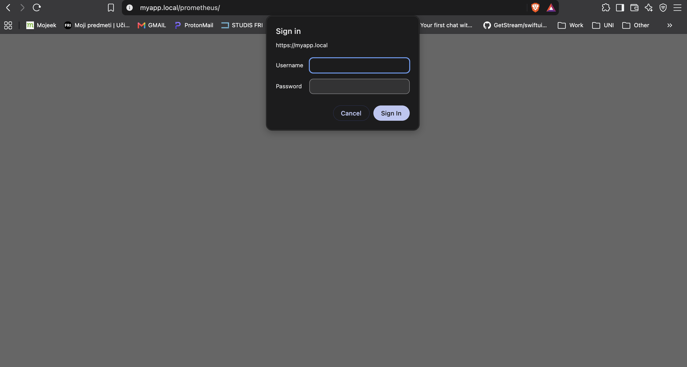
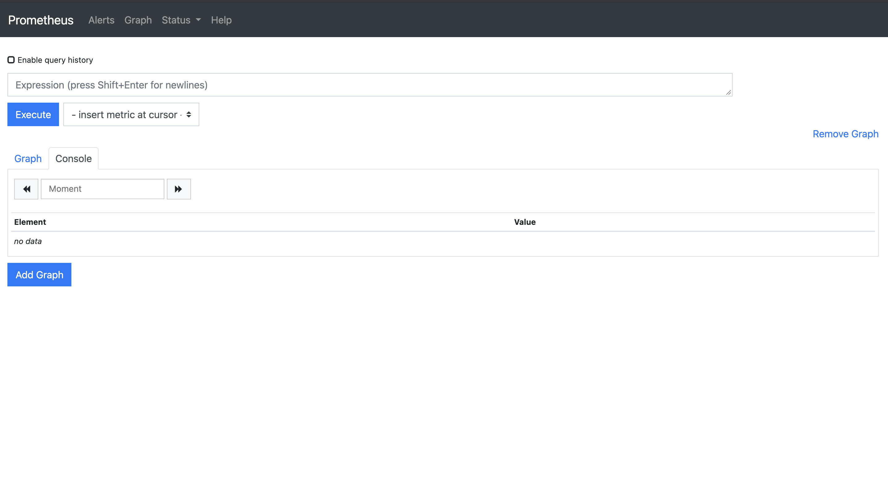
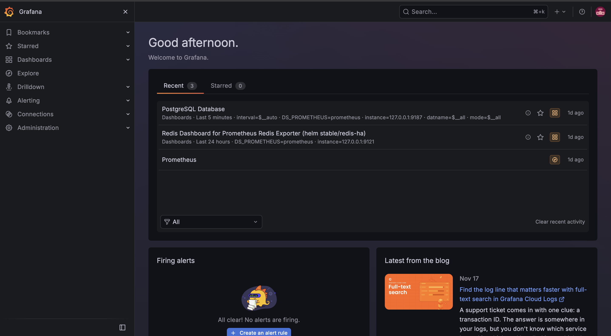
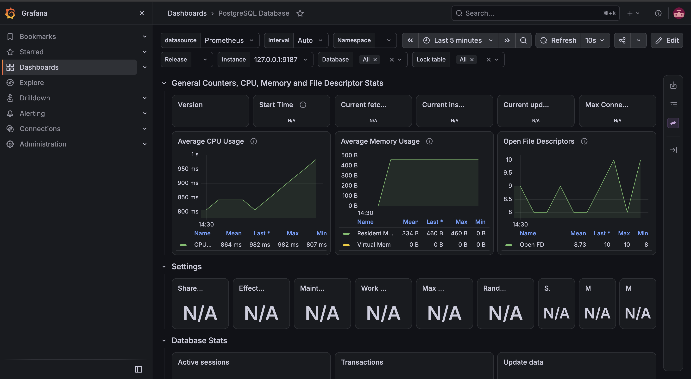

# Automated Rails Deployment With Vagrant

# 1.Namen projekta

Cilj je bil da pokažemo kako lahko spletno aplikacijo deployamo varno in večktrat z uporabo samo enega ukaza na MAC-OS.
Za virtualko uporabimo Ubuntu 24.04 box in provision skripte ki:
  - Inštalira in konfigurira vsak servis, ki ga aplikacija potrebuje (PostgreSQL,Redis,Ruby,Puma,nginx)
  - Inštalira celoten monitoring in logging stack
  - Verificira da vse dela z avtomatiziranim "smoke test"
  - Uporabi različne varnostne mehanizme (HTTPS,protekcije pred brute force,firewall,SSH)
  - Celotna aplikacija se lahko izbriše/ustavi in ponovno zgradi
  - Skripte so varne, da jih ponovno zaženemo ter je vgrajena trajnost(podatki shranijo ob ponovnem zagonu - samo brez --provision)


# 2.Dodatne funkcionalnosti (bolj podbrobno)

## Avtomatzacija

  - Oštevilčene modularne provizije 00-99,vsak lahko zaženemo posebej z vagrant provision --provision-with ime_provision
  - Ponovni zagon skript ne duplicira konfiguracije ali regenerira obstoječe skrivnosti/ključe
  - Vgrajen smoke-test. ki pregleda in testira provisioing, če je kaj narobe potem pade
  - Avtomatski sidekiq detekcija: če gemfile vsebuje sidekiq,"worker service" se kreira

## Varnost

  - **Netwowrk**: UFW firewall blokira ves vhodni promet razen na vratih 22,80,443,baze in monitoring; servisi poslušajo samo na localhost,fail2ban za SSH in nginx basic-auth
  - **SSH**: Root login disabled,max 4 poskusi,avtentikacijo samo z ključem
  - **Brute force zaščita**: fail2ban prepoveduje dostop za  sshd in nginx-http-auth(5 poskusov - 1 hour ban)
  - **Skrivnosti**: Naključno generirane na okolje;nikoli "hardcoded"(Baza,Redis,SECRET_KEY_BASE in admin gesla),shranjeni v /etc/myapp z omejenimi pravicami(root:deploy 640 env file,root 600 credentials file)
  - **TLS**: Ves zunanji promet iz HTTPS; HTTP preusmeri na HTTPS,2 načina mkcert(lokalno zaupan CA za development) in letsencrypt(pravi certifikati prek Cloudflare DNS challenge z auto-renewal hook)
  - **Kernel**: SYN cookies,reverse-path filtering in ICMP redirect protekcija prek sysctl
## Monitoring and Logging

  - Centraliziran logging z Loki in Grafana Alloy(journal in log shipping)
  - Prometheus z node,PostgreSQL,redis in nginx exporterji
  - Persisent journald z storage size cap
  - Grafana z "data sources" in 3 community dashboards, ki so avtomatsko provizionirani
  - **Grafana** vizualizira Prometheus(metrics) in Loki(logs).Provisioned dashboard Node Exporter FUll(1860),PostgreSQL(9628),Redis(11835)
  - **Exporters** izpostavi/razkirje metrike za komponente, ki to ne morejo same
    -  Export            Port        Metrics
    - node-exporter     9100        CPU,RAM,Disk
    - postgres-exporter 9187        povezave,transkacije,velikost PB
    - redis-exporter    9121        memory,hit rate,clients
    -  nginx-exporter    9113        povezave,zahteve
  - **Alloy** zbira journal/dnevnik od systemd in loga datoteke in jih pošlje Loki.
  - **Promethueus** "scrapa" /metrics od vsakega exporterja vsakih 15s in shrani time series(7 dnevna shramba/zadrževanje)


## Backups

  - Vsakodnevni pg_dump prek systemd timerja,7 dnevnno zadržanje podatkov,ena varnostna kopija ustvarjena ob provisionu

## Prilagajanje virov

  - Redis memory cap in lru policy,Puma workers/threads konfigurirane prek env

## Testing

  **99-smoketest.sh provisioner teče avtomatsko in preveri**:
  - če so vsi od 13 servisev aktivnih
  - Grafana health prek nginx
  - PostgreSQL query in Redis overjen PING
  - HTTPS app(/up) in HTTP -> HTTPS redirect
  - Firewall je aktiven in varnostna kopija baze obstaja
  - Prometheus potrebuje avtentikacijo in pote lahko delamo z njo
  - All Prometheus targets up

# 3.Potrebe

  - macOS
  - Vagrant z Vagrant VMWare utiliy(lahko uporabite virtualbox samo morate spremeniti vagrant file in ponovno zagnati)
  - VMWare Fusion/Virtual box
  - Vagrant in vagrant plugins(```vagrant plugin install vagrant-vmware-desktop```)
  - Dostop do interneta na prvem zagonu ter še dovolj CPU in RAM.

# 4.Vagrant Setup

## Git clone

```bash
git clone https://github.com/aneltoric123/sk-44-virtualization
cd vagrant  
vagrant up --provision
```

### Sprva vam ne bo delalo in bo trajalo kar precej časa za zagon,dokler ne spremenite /etc/hosts in dodate kar vam piše v zadnji vrstici ukaza.
```bash
sudo nano /etc/hosts
```

## Zaupamo certifikatom (da pokaže validen "lock" in morate ponovni zagnati browser)
```bash
sudo security add-trusted-cert -d -r trustRoot \
  -k /Library/Keychains/System.keychain ./certs/rootCA.pem
```
## Gremo na spletno stran

**https://myapp.local/**
**https://myapp.local/up** (Health check)
**https://myapp.local/grafana/** (Grafana login podatki v terminalu)
**https://myapp.local/prometheus/** (Prometheus login podatki v terminalu)

## Ostale Vagrant komande

- ``` vagrant halt ```(ustvai VM)
- ``` vagrant up ```(zažene Vm brez provisioning razen pri prvem zagonu)
- ``` vagrant ssh ``` (SSH od VM)
- ``` vagrant reload ```(ekvivalent če kličemo ```vagrant halt``` potem ``` vagrant up ```,provisinioning ne bo ponovno zagnan,zato moramo uporabiti --provision)
- ``` vagrant up --provision ```(zažene vse provisionarje)
- ``` vagrant destroy -f ```(ustavi/izbriše vagrant mašino ter še podatke oz.vire,ki so bili ustvarjeni med pospopkom ustvarjanja Vagrant)

# VAGRANT SLIKE IN POSNETKI








